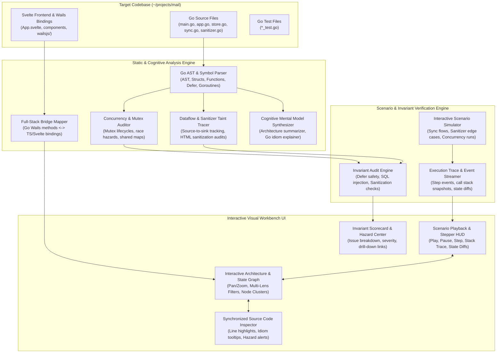

# Architecture Research: Codebase Verification & Understanding Workbench

## System Architecture

The tool is structured as a high-performance, modular analysis and visual verification workbench.



## Data Models

### 1. CodebaseTopology
```typescript
interface CodebaseTopology {
  modules: ModuleNode[];
  functions: FunctionNode[];
  structs: StructNode[];
  edges: DependencyEdge[];
  concurrencyHazards: ConcurrencyHazard[];
  securityFlows: SecurityFlow[];
  bridgeEndpoints: BridgeEndpoint[];
  invariants: InvariantCheck[];
}
```

### 2. ScenarioTrace
```typescript
interface ScenarioStep {
  stepIndex: number;
  description: string;
  activeNodeId: string;
  sourceFile: string;
  sourceLine: number;
  callStack: string[];
  mutexState: { [mutexName: string]: "UNLOCKED" | "LOCKED_EXCLUSIVE" | "LOCKED_SHARED" };
  goroutineCount: number;
  dataMutations: { [key: string]: any };
  hazardsTriggered?: string[];
}
```
